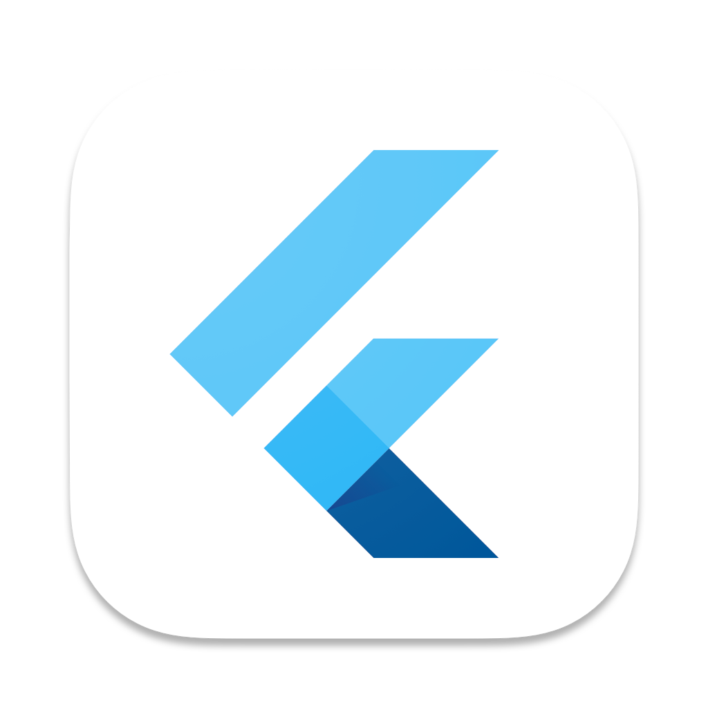

<p align="center">
  
</p>

# AquaMRX 🚤

> **An advanced IoT Marine Autonomous Surface Vessel (ASV) mission control, telemetry monitoring, and remote navigation platform built with Flutter, Mapbox, and Firebase Realtime Database.**

[](#)
[](#)
[](#)
[](#)
[](#)
[](#)

---

## 🌊 Overview & System Architecture

AquaMRX bridges autonomous marine hardware with intuitive mobile command interfaces. The application operates in two synchronized modes:

```
┌─────────────────────────────────┐           ┌─────────────────────────────────┐
│     🚢 PRODUCT MODE (BOAT)      │           │    🎮 CONTROLLER MODE (BASE)    │
│  - On-board Camera Sensor       │           │  - Live Video Stream Viewer     │
│  - High-precision GPS (Lat/Lng) │  ──────>  │  - Fullscreen Mapbox Tracking   │
│  - Water Quality Sensors:       │  Firebase │  - Real-time Telemetry Dashboard│
│    • TDS (ppm)                  │  Realtime │    (TDS, pH, Temperature)       │
│    • pH level                   │  Database │  - Dynamic Direction Control Pad│
│    • Water Temperature (°C)     │  <──────  │    (Forward, Left, Stop, Right) │
└─────────────────────────────────┘           └─────────────────────────────────┘
```

---

## 📱 Interface & Operational Modes

### 1. 🎮 Controller Mode — Mission Control Center
* **Live Video Feed:** Real-time visual monitoring streamed directly from the vessel's on-board camera with gapless playback.
* **Fullscreen Mapbox Navigation:** Live satellite and vector map rendering showing current coordinates (`lat`, `lng`) and historical vessel trajectory.
* **Water Quality Telemetry Cards:**
  * **TDS:** Total Dissolved Solids measured in parts per million (**ppm**) for water purity assessment.
  * **pH:** Acidity / alkalinity levels with critical threshold tracking.
  * **Temperature:** High-accuracy water temperature monitoring in **°C**.
* **Remote Navigation Controls:** Low-latency directional steering pad dispatching direction commands (`forward`, `left`, `stop`, `right`) via Firebase.

### 2. 🚢 Product Mode — Vessel Hardware Node
* **On-Board Camera Capture:** Continuous camera frame acquisition and transmission over secure web channels.
* **Geolocator GPS Stream:** High-frequency location updates broadcasting GPS latitude and longitude.
* **Automated Fail-safe:** Network timeout detection and emergency stop listeners.

---

## 🛠️ Technology Stack

| Layer | Technologies |
|---|---|
| **Mobile Framework** | Flutter 3.x (Material 3 Design) |
| **Programming Language** | Dart 3.10+ |
| **Geospatial & Mapping** | Mapbox Maps Flutter SDK, `flutter_map`, `latlong2` |
| **Cloud & Realtime Sync** | Firebase Core, Firebase Realtime Database |
| **Hardware Integration** | `camera`, `geolocator`, `location` |
| **State & Lifecycle** | `provider`, asynchronous stream subscriptions |

---

## 📂 Project Structure

```
aquamrx/
├── docs/
│   └── screenshots/          # App emblems & visual documentation
├── android/                  # Native Android configuration
├── ios/                      # Native iOS project
├── lib/
│   ├── firebase_options.dart # Firebase environment credentials
│   └── main.dart             # Main application entry point & dashboards
│       ├── ModeSelectionScreen
│       ├── ControllerDashboard (Mission Control)
│       ├── ProductDashboard (Boat Hardware Node)
│       └── MapboxMapScreen (Live Navigation)
└── pubspec.yaml              # Dependencies and Flutter configurations
```

---

## 🚀 Getting Started

### Prerequisites
1. Flutter SDK (>= 3.10.7)
2. Android Studio / Xcode
3. Mapbox Access Token
4. Configured `google-services.json` (Android) / `GoogleService-Info.plist` (iOS)

### Installation
```bash
# Clone the repository
git clone git@github.com:AkashJanawad/AquaMRX.git
cd aquamrx

# Install dependencies
flutter pub get

# Launch the app (with your Mapbox access token)
flutter run --dart-define=MAPBOX_TOKEN="YOUR_MAPBOX_ACCESS_TOKEN"
```

---

## 📄 License
This project is licensed under the [MIT License](LICENSE).
